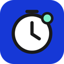

### Hi, I'm Ana Rosiris 👋

I build **plugins for Moodle™** at [eLearning Fácil](https://elearningfacil.com/?utm_source=github&utm_medium=profile): tools that save training providers and companies hours of admin work — real learning time, audit-ready reports and seat-based classrooms.

*Desarrollo plugins para Moodle™ en [eLearning Fácil](https://elearningfacil.com/?utm_source=github&utm_medium=profile): herramientas que ahorran horas de trabajo a centros de formación y empresas.*

## 💼 Ready to buy · A la venta

| Product | What it does | |
|---|---|---|
| **Training Evidence Pack** *Pack Formación Bonificada Pro* | Nine plugins that prove every hour of training: each student's real active time, date-stamped tutoring, assessments and an audit-ready file for every group and company. FUNDAE® ready in Spain. | [See the Pack →](https://elearningfacil.com/pack-fundae-moodle/?utm_source=github&utm_medium=profile) |
| **Class Manager** *Gestor de Aula* | Sell or rent your courses by seats: each client company signs up and manages its own students in your Moodle™, within the seats it bought. | [See Class Manager →](https://elearningfacil.com/alquila-moodle-por-aulas-plugin/?utm_source=github&utm_medium=profile) |

**Want it done for you?** We install and set up the plugins on your Moodle™, run your training platform and offer one-to-one advice: [services](https://elearningfacil.com/plataforma-formacion-moodle/?utm_source=github&utm_medium=profile) · [contact](https://elearningfacil.com/contacto/?utm_source=github&utm_medium=profile) (we answer in English and Spanish).

## 🎁 Free plugins for Moodle™

| | Plugin | What it does | Moodle™ |
|---|---|---|---|
|  | **[Direct SCORM Player](https://github.com/anarosiris/moodle-local_efscorm)** `local_efscorm` | One click and the student is right inside the SCORM: no “Enter” page, full screen in the same tab, no blocked pop-ups. | 5.1 · 5.2 · 5.3 |
|  | **[Training Evidence: Time Clock](https://github.com/anarosiris/moodle-local_eftimeclock)** `local_eftimeclock` | Moodle™ logs clicks; this measures time: only while the activity tab is in focus, with an on-screen clock and an Excel/CSV report. | 5.1 · 5.2 · 5.3 |
|  | **[Training Evidence: My Progress](https://github.com/anarosiris/moodle-block_efprogress)** `block_efprogress` | A block where every student sees how much is left: a progress ring and one clickable mark per activity. | 5.1 · 5.2 · 5.3 |

Questions and bug reports for the commercial plugins: [elearningfacil-support](https://github.com/anarosiris/elearningfacil-support).

---

Developed and maintained by eLearning Fácil (https://elearningfacil.com), an independent company that builds plugins for Moodle™ for training providers and companies. Not affiliated with Moodle Pty Ltd. Moodle™ is a registered trademark of Moodle Pty Ltd. FUNDAE® is a registered trademark of Fundación Estatal para la Formación en el Empleo; eLearning Fácil is not affiliated with it.
